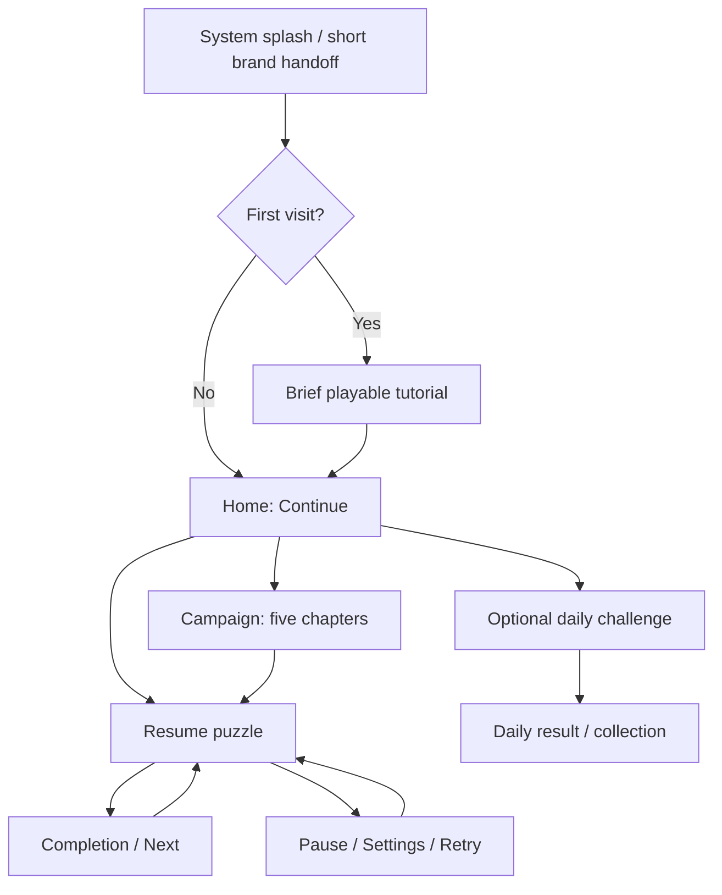

# Tap Away — Research, Task List and Phased Redesign Plan

**Date:** 10 October 2026 (Asia/Karachi)  
**Project:** `D:\arrowsapp` · Kotlin / Jetpack Compose · `com.amowpuzzle.aitricker`  
**Status:** RESEARCH AND PLANNING ONLY. This document does not authorize implementation.

## 1. Scope and decisions

The immediate deliverable is this researched, verified plan. No app source, resources, level coordinates, dependencies or settings are to change during this planning task. Earlier guitar edits predate the planning-only request; they remain in the workspace and are not presented here as new work or a fully verified release.

Future redesign decisions:

- Retain the existing Android/Compose architecture, navigation, level model and local storage.
- Preserve the exact puzzle data and stable IDs of Levels 2–50, plus existing completion progress. Repainting their UI is different from replacing their layouts.
- Keep the authored guitar silhouette and explicit Level 1 coordinates as a baseline. The latest colorful-3D direction is the proposed future visual target, superseding the earlier white-only styling for this redesign. Nothing is recolored now.
- Progressively straightening arrows are the intended future behavior. Changing movement requires collision and difficulty revalidation; it is not an animation-only patch.
- Use screenshots for composition, density, clarity and polish. Do not copy promotional headings, phone/system bars, branding or screenshot pixels into gameplay.
- Keep the core offline. Accounts, advertising, payments and a shop are not necessary for a complete game. Daily challenges and cosmetic progress below are proposed additions, not existing features.
- Aim for satisfying decisions, reliable input, mastery and replay value. A redesign cannot guarantee addiction or retention.

This is the current plan. `REDESIGN_PLAN.md`, dated 5 September 2026, is historical: some claims about missing icons, transitions and rendering are now outdated. Preserve that file rather than silently overwrite it.

## 2. Screenshot observations

| Reference | Visible observation | Design implication |
|---|---|---|
| First: current Level 3, eight colored arrows | Thick glossy shafts, large heads/shadows, substantial blank space, detached status chips and bottom buttons | Some 3D styling already exists. Improve composition, depth restraint and grouped controls instead of repeating oversized arrows |
| Second: “Find the Free Path”, Level 42 | Dense thin winding paths, clear tips, compact status area, hint/grid buttons, magnified detail | Use as a dense-board readability benchmark. Headline/magnifier are promotional presentation, not mandatory game UI |
| Third: daily board with 110 arrows | Long rectangular maze, frequent turns, tight gaps, mixed path lengths | Density requires real path geometry. Scaling eight arrows cannot create 110 independent arrows |
| Fourth: Level 4, nine arrows | Small interlocking knot is readable despite few pieces | Interlocking geometry can make low-count levels interesting; count alone is not difficulty |
| Earlier guitar reference | Lower-left body, cutaway, diagonal neck and upper-right headstock | Preserve that specific silhouette rather than substitute a generic guitar or rectangular board |

**Target:** combine winding, readable puzzle geometry with original multicolor soft-3D materials and coordinated game UI. Dense arrows use restrained depth; cards and buttons carry stronger tactile treatment.

Static screenshots do not establish competitor animation timings, collision algorithms, onboarding sequence or retention. Evidence and our proposed decisions are distinguished below.

## 3. Current-project audit

These are source observations, not claims that the current APK has passed device QA.

| Local evidence | Present now | Actual next step |
|---|---|---|
| `ui/components/ArrowSkin.kt` | Stable colors, clay shadows, darker side and highlight | Refine the existing material for dense boards; do not claim 3D shading is absent |
| `Clay.kt`, `ui/theme/DesignTokens.kt` | Shared surfaces, radii, spacing and press tokens | Apply consistently to whole header/dock and every card size/state |
| `AppIcons.kt`, `res/drawable/ic_*.xml` | Material-style vector resources already load through `Icon` / `painterResource`; controls are not emoji | Audit official provenance, family, weight, padding and labels; replace only incorrect assets |
| `presentation/game/GameScreen.kt` | Separate header, status row and controls | Create deliberate top and bottom panels without squeezing the board |
| `presentation/navigation/AppNavigation.kt` | Forward/back fade and small scale already exist | Tune route behavior and reduced motion; avoid duplicate effects |
| `presentation/splash/SplashScreen.kt` | Intro includes a fixed 1,450 ms wait before a 280 ms exit | Avoid a repetitive second splash or artificial waits |
| `presentation/tutorial/TutorialScreen.kt` | Five explanation pages | Add a short playable first-run lesson and replayable help |
| `presentation/menu/MainMenuScreen.kt` | Hero tile, progress, Play/Continue/Levels | Refine hierarchy and make Continue resume a genuine unfinished session |
| `presentation/levels/LevelSelectScreen.kt` | Four-column grid | A chapter journey map is still proposed, not implemented |
| `data/prefs/GamePreferences.kt` | Unlocked/completed levels and settings persist | Add versioned session/reward data without erasing old progress |
| `BoardGeometry.kt` | Vertex-to-line straightening morph | Replace with path-following withdrawal; current interpolation is not length-preserving |
| `ArrowBoard.kt`, `MovementRule.kt` | Earlier guitar changes select white styling, zoom and rigid full-body movement | Reconcile the latest color/motion brief before claiming final difficulty |
| `GuitarLevel.kt`, new guitar/preservation tests | Explicit guitar data and validation fixtures from earlier work | Preserve baseline and rerun after future movement changes; planning does not certify an Android release |

The old morph has a specific mathematical risk: at 50% interpolation, a perpendicular segment shrinks to about 70.7% length, while an opposite-facing segment can collapse to zero. The rounded-path helper needs zero-length guards. This is a code/math finding, not a reproduced device crash.

## 4. Research and adopted recommendations

Sources accessed 10 October 2026. Official platform documentation and publisher descriptions are primary evidence. Later color values and timings are design proposals, not universal industry rules.

| Verified finding | Decision for this game | Primary source |
|---|---|---|
| Easybrain describes ordered removal, blocked-tap life loss, hints, increasing complexity, daily challenges and no timer | Keep a simple main loop, prioritize clarity, add optional daily variety later | [Easybrain developer listing](https://play.google.com/store/apps/details?id=com.easybrain.arrow.puzzle.game) |
| King's support describes Saga Map progress, episodes and milestone levels | Group our 50 levels into five chapters; five-by-ten is our choice | [King progression example](https://candycrush.zendesk.com/hc/en-us/articles/38903254427933--Music-Season) |
| Google's game guidance favors brief/contextual learning, distinct button states and clear pause/end states | Playable tutorial, coherent controls, explicit resume and campaign ending | [Google game design practices](https://developers.google.com/youtube/gaming/playables/certification/best_practices_design) |
| Android recommends current Material Symbols XML rather than the old Compose material-icons artifact | Bundle a small Rounded family; reuse existing wrappers | [Android icons](https://developer.android.com/develop/ui/compose/graphics/images/material) |
| Material Symbols provide coordinated styles/weights/fill | Record selected asset sources and retain applicable license/notice material | [Google Symbols guide](https://developers.google.com/fonts/docs/material_symbols) |
| Compose recommends adequate target sizes and warns that automatic target expansion can overlap | Explicitly space controls; use zoom and precise hit geometry for dense arrows | [Compose accessibility](https://developer.android.com/develop/ui/compose/accessibility/api-defaults) |
| Android has a branded system splash and an exit handoff | One coherent launch without a compulsory long second intro | [Android splash screens](https://developer.android.com/develop/ui/views/launch/splash-screen) |
| Compose supports cached drawing objects and deferred state reads | Cache static geometry and animate changed parts only | [Drawing](https://developer.android.com/develop/ui/compose/graphics/draw/overview), [performance phases](https://developer.android.com/develop/ui/compose/performance/phases) |
| Performance guidance discourages repeated expensive composition work | Profile release builds and scoped invalidation first | [Compose performance](https://developer.android.com/develop/ui/compose/performance/bestpractices) |
| Swappy targets OpenGL/Vulkan render loops | It is not the first tool for this Compose Canvas game | [Android Frame Pacing](https://developer.android.com/games/sdk/frame-pacing) |
| Window size can change independently of device label | Adapt to available dimensions and insets | [Window size classes](https://developer.android.com/develop/ui/compose/layouts/adaptive/use-window-size-classes) |

Publisher descriptions establish feature patterns, not retention results. Continue-first Home, five chapters and cosmetic rewards are decisions tailored to this project.

## 5. Visual design specification

### 5.1 Shared game material

Proposed initial palette: page `#F4F6FC`, board `#FFFCF7`, deep navy top card `#203052`, pale blue bottom card `#DDEBFF`, text `#17243D`. Chapter accents vary while surface roles stay recognizable. Check contrast before implementation.

Use a 4 dp spacing scale; roughly 12–16 dp chip radii, 20–24 dp cards and 24–28 dp panels. Cards have a shallow darker underside, restrained contact shadow and fine top highlight. Buttons compress briefly on press. Hero cards, tiny counters, chapter nodes, settings rows, dialogs and rewards must share the same material.

Avoid large grey shadow slabs, overly deep tiny arrows and simultaneous bouncing everywhere. Elevation should clarify hierarchy rather than compete with the board.

### 5.2 Multicolor soft-3D arrows

- Keep a small deterministic palette: blue, teal, green, amber, coral, violet and indigo; test adjacent colors and board contrast.
- Use consistent top faces, narrow darker sides and restrained highlights inside the existing Compose renderer. No new 3D engine is necessary.
- Head size stays proportional to the shaft and readable on the smallest piece.
- Color is identity/decoration, never a signal of solvability.
- Reduce shadow/highlight complexity on dense zoomed-out boards before enlarging strokes. The complete visual footprint must leave visible gaps.
- Scale logical coordinates uniformly; visual shadows do not determine collision ownership.
- Provide high-contrast/simple-material and reduced-motion options. Direction and state must remain clear without color discrimination.

### 5.3 Gameplay composition

```text
┌────────────────────────────────────┐
│ TINTED TOP CARD                     │
│ Back        Level / chapter   Gear  │
│ Arrows left    Hearts   Difficulty  │
└────────────────────────────────────┘

        PROPORTIONALLY FIT BOARD
   Winding paths; restrained depth;
   no decoration over touch targets

┌────────────────────────────────────┐
│ DIFFERENT TINTED BOTTOM CARD         │
│ Hint [count]       Grid       Fit   │
│       zoom controls when needed    │
└────────────────────────────────────┘
```

Starting compact-portrait targets: 12–16 dp outer margins, approximately 96–112 dp top panel and 80–104 dp bottom panel; the remaining safe area belongs to the board. These are flexible constraints, not fixed pixel heights. Large text wraps/reflows rather than covering arrows.

Small boards use a deliberate content frame, not enormous shafts stretched across whitespace. Dense boards occupy more of the available region. Fit preserves the full composition and aspect ratio; pinch zoom anchors to its centroid, pan stays bounded and Fit restores the whole puzzle. Panning or zooming must never spend a life.

### 5.4 Bottom controls and icons

| Action | Proposed Material Symbol | Behavior |
|---|---|---|
| Hint | `lightbulb` | Valid move, count and clear unavailable state |
| Grid | `grid_on` | Subtle guide; persistent pressed state |
| Fit | `fit_screen` | Restore full composition without gameplay cost |
| Zoom | `add`, `remove` | Explicit target space and limits |
| Back / settings | `arrow_back`, `settings` | Predictable navigation; retain active board |
| Retry / close | `replay`, `close` | Clear semantics and progress-loss handling |
| Campaign / daily / achievement | `map`, `calendar_month`, `emoji_events` | Only appear with working features; these are vector asset names, not emoji characters |

Audit the existing vectors first; replace inconsistent assets rather than rebuilding the whole wrapper. Use approximately 24 dp artwork in explicit 48–56 dp controls, sufficient spacing, useful text labels and content descriptions. Do not ship a mysterious arrow button: Play Solution remains debug-only. Do not invent a ruler tool just because a reference contains one.

## 6. Progressive escape: motion and collision together

The desired effect is a ribbon being pulled out. Its head advances along the exit direction while the body follows the existing path and its tail progressively leaves each bend. It must not move off screen as a rigid L/U or collapse sideways into a straight line.

**Proposed shared geometry:** parameterize the original tail-to-head centerline `C(s)` by distance, with length `L`. Extend it past the head: `C(L + q) = head + q × exitDirection`. At travel distance `d`, draw `C([d, d + L])`.

This ensures that the head follows the exit ray, the tail follows the original bends, the length remains `L`, and the arrow is entirely straight once `d >= L`. No vertex is dragged diagonally through its neighbor.

Measure the same rounded centerline used by the renderer, including small end extensions. Cache cumulative lengths and interpolate interval endpoints; stationary pieces are not rebuilt every frame. Handle zero-length/repeated points explicitly. The official [Compose Android PathMeasure implementation](https://android.googlesource.com/platform/frameworks/support/+/b8db4b696392c7c5ced801886d0945be70455e93/compose/ui/ui-graphics/src/androidMain/kotlin/androidx/compose/ui/graphics/AndroidPathMeasure.android.kt) provides a concrete candidate for length and segment extraction.

**Collision contract:** taps, hints, solver, replay and animation share the same movement. Check real occupied path geometry and the newly swept extension, including shaft/head clearance. A valid withdrawing body vacates its original route and adds occupied space along the forward extension; it does not sweep the entire original shape sideways. Validate this simplification independently, including own-body intersections and tightly packed corners. Decorative shadows are not obstacles.

**Guitar consequence:** a read-only diagnostic on its current explicit data found 12 openings and 31 removal rounds under the head-corridor rule, versus one opening and 62 rounds under rigid translation. This is not a validated rounded-motion implementation. Earlier expert metrics therefore cannot be claimed unchanged after straightening is introduced. Settle the movement policy in Phase 2, then revalidate difficulty in Phase 6. If maintaining the expert target requires a small Level 1 coordinate revision, prepare its exact comparison for a future implementation decision; never silently change Levels 2–50.

Proposed tuning ranges: about 280–700 ms per escape based on screen-space travel, 80–110 ms press feedback and 120–180 ms blocked feedback. These are playtest starting values. Move the head, material layers and hit state together. Blocked feedback follows the same route briefly and returns. Reserve a departing piece's geometry until subsequent motion is physically safe; begin with short serialized departures and add concurrency only with explicit reservations. Completion waits for departure callbacks, not an unrelated fixed timer.

## 7. First screen, second screen and full player journey

There is no verified universal first/second-screen sequence for every successful game. Recommended flow for this project:



- **First screen — launch:** branded system splash with a short handoff. Dismiss when ready, without an artificial wait. Background resume does not replay a long introduction.
- **Second screen — new player:** small playable practice board teaching free/blocked taps, a withdrawing bend and Hint/Grid. Separate from the 50 campaign layouts; skippable and replayable. It must not force a beginner directly into the expert guitar without explanation.
- **Second screen — returning player:** Home immediately, without repeated tutorial.
- **Home/main:** primary Continue card with level and genuine saved-session progress; Campaign; optional Daily only after it works; quieter Settings/How to Play. Small brand motion, calm background.
- **Campaign:** five chapters of ten with themed locked/current/completed nodes and non-color indicators. Focus the current level automatically and retain scroll position. Label Level 1's special expert status honestly instead of presenting it as an easy introduction.
- **Game:** distinct top panel, dominant board and bottom dock. Back/Settings retain active arrows, hints, lives and camera. Retry clearly restarts an attempt.
- **Completion:** brief celebration, meaningful result, prominent Next, secondary Replay and Campaign/Home. Level 50 gets a real campaign-complete state, not a broken Level 51 link.
- **Pause/loss/settings:** coordinated cards, clear resume/retry, independent music/sound/haptics, motion/accessibility options and deliberate reset-progress confirmation.

Forward/back transitions already exist. Refine them with short fades and subtle depth/directional motion; start around 180–260 ms and a restrained scale change. Returning should restore the board rather than feel like a fresh launch. Reduced motion uses a simple short fade or immediate state change. All durations require device evaluation.

## 8. Engagement and content

Core loop: inspect → identify a dependency → tap → readable withdrawal and feedback → new opening → solve → visible progress → choose the next challenge.

Use mastery, varied silhouettes/turns, chapter milestones and optional daily puzzles for replay value. Cosmetic badges or chapter artwork are sufficient rewards; grind currency and a compulsory shop are unnecessary.

Propose clear records: solved, perfect attempt (no blocked taps), unassisted attempt (no hints). Explain criteria. Avoid speed pressure in a no-timer logic game; hints should support learning rather than invalidate completion.

Measure density and difficulty separately: opening choices, dependency depth, path-length mix, turns, occupancy and observed solve rate. An eight-arrow board can be engaging; decorative unplayable lines cannot fake a 110-arrow maze. Because Levels 2–50 are protected, richer additional layouts belong in a challenge/daily catalog or a separately reviewed future content revision.

Daily proposal: bundled solver-validated boards, a documented local-date policy, separate campaign/daily progress, deterministic handling of timezone changes/relaunch/clock rollback and no duplicate rewards. Offline time is not globally synchronized or cheat-proof. Missing a day never removes earned campaign progress. Online rankings, notification campaigns and seasonal live systems are outside the first release.

Use small playtests to assess understanding, accidental taps, hint use, completion rate, difficulty and voluntary continuation. These are evaluation measures, not guaranteed retention. Keep measurement local unless online analytics is separately requested.

## 9. Complete phased task list

Checkboxes here are future implementation work, not work authorized now. Planning completion is recorded in section 12.

### Phase 0 — Preserve and measure the baseline

- [ ] Record source, level and save-schema baselines; capture existing Home, tutorial, easy board, dense board and guitar.
- [ ] Preserve Levels 2–50 hashes and saved progress; record the special Level 1 policy.
- [ ] Measure actual startup, release frame timing and input; record existing build failures honestly.
- [ ] Prepare matched-size reference comparison sheets.

**Exit:** an honest baseline; unfinished builds are not treated as passed QA.  
**Later files:** regression fixtures and QA artifacts; no puzzle redesign here.

### Phase 1 — Resolve visual direction

- [ ] Make original mockups of launch, tutorial, Home, campaign, gameplay, completion and settings.
- [ ] Include an 8–9-arrow board, a 99–110-arrow dense board and the guitar.
- [ ] Define colors/contrast, spacing, typography, card depth, arrow material, icon family and all control states.
- [ ] Review compact phone, larger window and large-text layouts.

**Exit:** mockups resolve the sparse/detached appearance and preserve clear playable gaps.  
**Depends on:** Phase 0. **Later files:** `Palette.kt`, `DesignTokens.kt`, `Type.kt`.

### Phase 2 — Correct withdrawal and movement rules

- [ ] Prototype measured-path withdrawal on straight, L, U, zigzag and long winding paths in four directions.
- [ ] Share motion geometry between drawing, collisions, hints and solver.
- [ ] Handle degenerate points, blocked response, departure lifetime and completion callbacks.
- [ ] Recompute guitar openings and dependency depth using the new rule.
- [ ] Prove complete valid solutions for every affected level without changing protected campaign coordinates.

**Exit:** frame-by-frame straightening without sideways crossing/collapse, with matching solver certificates.  
**Depends on:** Phase 0; may run alongside visual design. **Later files:** `BoardGeometry.kt`, `ArrowBoard.kt`, `CollisionEngine.kt`, `PuzzleSolver.kt`, `GameViewModel.kt` and focused tests.

### Phase 3 — Shared material, cards and icons

- [ ] Refine existing arrow layers for both sparse and dense boards.
- [ ] Standardize every card size, counter, badge, node, dialog and pressed/disabled state.
- [ ] Audit/replace Material Symbols where necessary; centralize sizes and record asset origins/licenses.
- [ ] Add high-contrast/simple-material and reduced-motion behavior.

**Exit:** complete component/state preview sheet; no emoji controls or closed path gaps.  
**Depends on:** Phases 1–2. **Later files:** `ArrowSkin.kt`, `Clay.kt`, `GameChrome.kt`, `AppIcons.kt`, vector resources.

### Phase 4 — Gameplay layout and dependable input

- [ ] Add distinct themed top/bottom panels with the board as the main content.
- [ ] Fit boards without stretching; retain guitar orientation and full silhouette.
- [ ] Integrate Hint, Grid, Fit and zoom with correct labels, counts and states.
- [ ] Use inverse camera transforms and nearest-path selection; reject ambiguous taps without life loss.
- [ ] Separate taps, drag, pinch, button interactions and back gestures; test dense clusters and screen edges.
- [ ] Preserve camera/session state through settings, navigation and backgrounding.

**Exit:** visual and touch checks pass at Fit and zoom, without covered controls or accidental life loss.  
**Depends on:** Phases 2–3. **Later files:** `GameScreen.kt`, `ArrowBoard.kt`, `BoardViewport.kt`, `BoardGestures.kt`, session state.

### Phase 5 — Complete screen journey and transitions

- [ ] Unify system splash/brand handoff and remove unnecessary repeat waits.
- [ ] Add short playable onboarding and direct returning-user Home.
- [ ] Refine Home with a primary Continue action and real unfinished-session resume.
- [ ] Build five-chapter presentation, current-level focus and preserved scrolling.
- [ ] Complete win, loss, pause, settings and campaign-ending states.
- [ ] Tune forward/back fade, subtle scale/depth and reduced-motion behavior.

**Exit:** first-install, returning and finished-campaign journeys have no dead ends or duplicate screens.  
**Depends on:** Phase 3; game integration also needs Phase 4. **Later files:** `presentation/*Screen.kt`, `AppNavigation.kt`, `MainActivity.kt`, local preferences/session storage.

### Phase 6 — Content, progression and expert difficulty

- [ ] Audit all 50 levels for solvability and difficulty labels under the final motion contract.
- [ ] Verify Levels 2–50 fingerprints remain identical.
- [ ] Review geometry density, bend variety and opening choices independently of color.
- [ ] Finalize guitar difficulty with explicit data and a complete recorded solution; document any proposed minimal coordinate revision.
- [ ] Define clear perfect/unassisted records and migration for already-completed saves.
- [ ] Put additional dense challenge content in a separate catalog unless existing-layout changes are expressly requested.

**Exit:** level certificates, preservation checks and playtest findings agree.  
**Depends on:** Phases 2 and 4. **Later files:** explicitly scoped content, solver tests and migration tests; `LevelCatalog.kt` only as authorized.

### Phase 7 — Return loop after the core is satisfying

- [ ] Add chapter milestones and local cosmetic completion records.
- [ ] Add the optional functioning Daily card, bundled schedule and results/collection screen.
- [ ] Handle local date/timezone changes and duplicate-reward prevention.
- [ ] Playtest session length, fairness and interest in another puzzle.

**Exit:** understandable rewards, solvable daily boards and unaffected campaign progress.  
**Depends on:** Phases 5–6. This is a proposed extension, not a requirement for monetization or online services.

### Phase 8 — Audio, micro-interactions, accessibility and performance

- [ ] Tune quiet tap/blocked/hint/completion sounds and light haptics; respect settings and lifecycle.
- [ ] Make presses, withdrawals, counters and celebrations feel consistent.
- [ ] Cache static geometry, scope animation invalidation and simplify dense-board layers when profiling supports it.
- [ ] Profile release builds during dense play, pinch/pan, transitions and repeated sessions.
- [ ] Test large text, contrast, reduced motion, target separation, spoken control labels and an accessible puzzle-selection/inspection method that does not reveal the solution.

**Exit:** measured smoothness on representative lower/mid-tier hardware, not just an emulator. Target stable 60 Hz where supported; 16.7 ms is a diagnostic frame budget, not an unmeasured guarantee.  
**Depends on:** integrated Phases 4–7; optional daily work need not delay core profiling.

### Phase 9 — Verification and complete-game handoff

- [ ] Run focused motion/solver/input tests and the existing regression suite.
- [ ] Verify save migration, process death, resume, pause, retry and Level 50 ending.
- [ ] Capture matched screenshots and slow-motion recordings of bends and dense input.
- [ ] Compare every major screen with mockups/reference observations; record remaining differences.
- [ ] Test small/tall portrait phones, larger windows, constrained height and system insets.
- [ ] Verify release behavior: no Play Solution/debug controls or unsupported buttons.
- [ ] Provide an installable build, QA report, known limitations and editable data/asset documentation.

**Exit:** agreed acceptance checks pass or exceptions are explicitly resolved before calling the game complete.  
**Depends on:** all required phases. A daily entry cannot appear in release unless its feature is complete.

**Dependency order:** baseline → visual design + movement prototype → shared components → gameplay → integrated screen flow/content validation → optional daily → polish/QA. Screen mockups and technical prototype may progress in parallel, but final difficulty validation follows the movement decision.

## 10. Acceptance criteria

| Area | Required evidence |
|---|---|
| Reference fidelity | Matched-size comparison of composition, density, line gaps, heads and card hierarchy; no unsupported “100% identical” claim |
| Straightening | Straight/L/U/zigzag recordings at multiple speeds; continuous head/tail motion; no rigid escape, diagonal cutting, shrink/collapse, NaN or detached head |
| Collision | Independent geometric oracle; all directions; shaft/head clearance; concave shapes; own-path and departing-piece interactions |
| Solvability | Complete independently replayed sequence for each affected level; hint uses the same rule |
| Guitar | Specific silhouette retained; new movement difficulty measured instead of reusing rigid-only metrics |
| Existing content/progress | Levels 2–50 hashes stable; old saves retained; sessions survive process death |
| Input | No life lost on pinch, drag, button, ambiguous gap or canceled touch; tested at Fit/max zoom |
| Material/icons | Readable multicolor depth; cohesive cards at every size; no emoji controls |
| Navigation | Correct new/returning flow, short handoff, predictable Back, preserved state and genuine Level 50 completion |
| Accessibility | Adequate target space, contrast, large text, reduced motion, non-color states and navigable puzzle controls |
| Performance | Named-device release traces, frame distributions, startup and memory stability; emulator evidence labeled separately |
| Engagement | Observed playtests of clarity, errors, difficulty and voluntary continuation; no retention claim based only on screenshots |

Motion tests sample start, before/after every bend, midpoint, just before the tail reaches the old head and full exit. They assert geometry and visible behavior, not only that an animation value reaches 1. [Compose animation testing](https://developer.android.com/develop/ui/compose/animation/testing) supports controlled-clock inspection for this purpose.

## 11. Requirement-to-phase verification

| ID | User request / retained constraint | Coverage | Verification |
|---|---|---|---|
| R01 | Inspect first screenshot and richer references | Sections 2–3; Phases 0–1 | Matched comparison sheet |
| R02 | Dense winding puzzle feel | Sections 5, 8; Phases 4, 6 | Density and playable geometry |
| R03 | Bent arrows become straight smoothly | Section 6; Phase 2 | Motion/geometry oracle |
| R04 | Distinct modern top card | Section 5.3; Phases 1, 4 | Mockup/device comparison |
| R05 | Modern bottom card and correct options | Sections 5.3–5.4; Phase 4 | States/input tests |
| R06 | Game feel for every small/large card | Section 5.1; Phase 3 | Component preview sheet |
| R07 | Google icons, no emoji | Section 5.4; Phase 3 | Asset/rendered audit |
| R08 | First, second and main screens | Section 7; Phase 5 | New/returning walkthrough |
| R09 | Research level-game methods first | Section 4 | Primary links and evidence/proposal distinction |
| R10 | Different colors and convincing 3D arrows | Section 5.2; Phase 3 | Dense/sparse material review |
| R11 | Smooth play | Sections 6, 10; Phases 2, 4, 8 | Input and release profiling |
| R12 | Interesting subtle forward/back fade | Section 7; Phase 5 | Navigation/reduced-motion video |
| R13 | Complete, engaging game | Sections 7–8; Phases 5–9 | Full journeys and playtests |
| R14 | Include all requests and research in tasks | Sections 4, 9, 11 | Coverage audit |
| R15 | Complete phase-wise plan | Section 9 | Dependencies and exit criteria |
| R16 | Verify, save root MD, no code now | Sections 1, 12 | Document review/source freeze |
| R17 | Preserve Levels 2–50 and existing progress | Sections 1, 3, 6; Phases 0, 6, 9 | Hashes and migrations |
| R18 | Specific authored guitar baseline | Sections 1–2, 6; Phase 6 | Silhouette and solution comparison |

## 12. Plan verification and limits

- [x] All four latest screenshots inspected; separated from the earlier guitar reference.
- [x] Current code inspected; existing clay materials, vectors and transitions acknowledged.
- [x] Official sources researched and direct links attached to findings.
- [x] Every user request mapped to tasks and acceptance evidence.
- [x] Animation, collision, hints and solver treated as one movement contract.
- [x] New straightening versus rigid guitar difficulty conflict quantified and assigned a phase.
- [x] Existing level data distinguished from global presentation changes.
- [x] Phases have dependencies/deliverables; optional daily expansion is identified.
- [x] Historical plan is not used as current implementation evidence.
- [x] This document does not authorize fresh app implementation.
- [ ] Independent final plan review and unchanged-source fingerprint check.

**Not verified now:** new mockups, redesigned input behavior, device frame rates, exact reference matching, final new-motion difficulty, daily behavior or retention. Those are future acceptance work. Prior guitar build/device validation was interrupted by the planning-only scope change; this document does not certify that build.

**Planning source freeze:** 98 files under `app/src`; combined SHA-256 `2af2831ccf019e440891b811db63b8c3da642d4a21c596645a734fd2561a9ac0`. Recheck before final handoff.

**Recommended next milestone when implementation is requested:** baseline capture, screen mockups and an isolated progressive-withdrawal prototype. Verify their visual and gameplay behavior before restyling every screen or adding daily systems.
